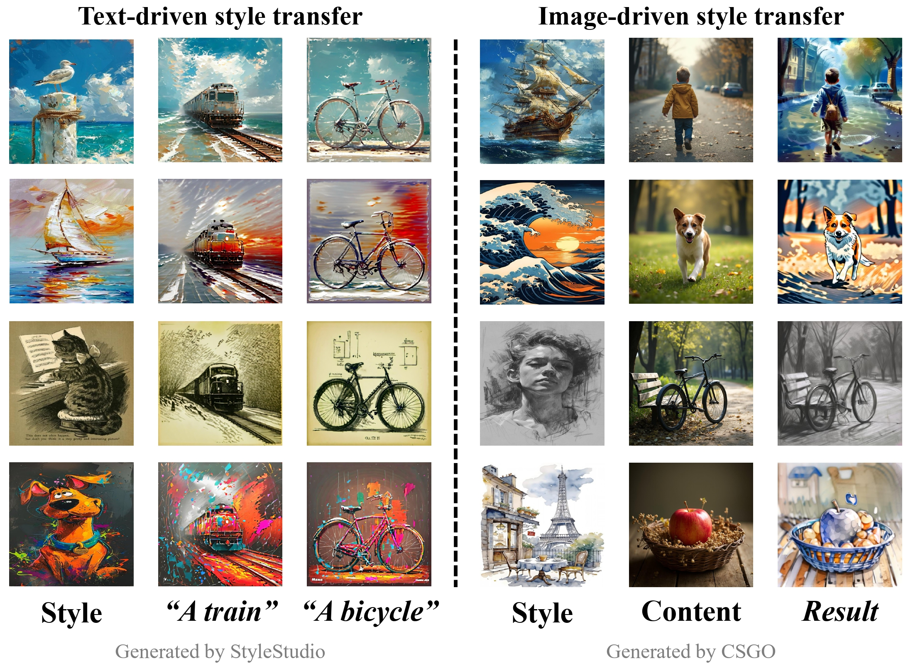

<!-- 

<h2> Awesome Style Transfer with Diffusion Models </h2> 

 -->
# 🥳Awesome Style Transfer with Diffusion Models  

# 🤗 Introduction
- This repository contains a curated list of **Style Transfer with Diffusion Models**. The resources are organized into two main categories: Image Synthesis and Video Synthesis. 
In the context of Image Style Transfer, the techniques can be categorized into two primary types: text-driven style transfer and image-driven style transfer.

  

- We welcome any contributions and suggestions to our repository or the addition of your own work. Feel free to make a pull request or leave your comments!!

# 📋 Contents
- [🤗 Introduction](#-introduction)
- [📋 Contents](#-contents)
- [💘 Tips](#-tips)
- [📍 Image Synthesis](#-image-synthesis)
  - [Fundation & Application Models](#foundation--application-models)
  - [Text-Driven Style Transfer](#text-driven-style-transfer)
    - [Image-Encoder Based](#image-encoder-based)
    - [Textual-Inversion Based](#textual-inversion-based)
    - [Swap Features In Attention Layer](#swap-features-in-attention-layer)
    - [Fine-tune Methods](#fine-tune-methods)
    - [Other Training-free Methods](#training-free-methods)
    - [Test-time optimization](#test-time-optimization)
  - [Image-Driven Style Transfer](#image-driven-style-transfer)
  - [LoRA-Based](#lora-based-methods)
  - [Text-Guided Style Transfer](#text-guided-style-transfer)
  - [None Diffusion Models](#none-diffusion-models)
- [📍 Video Synthesis](#-video-synthesis)
- [📍 3D Generation](#-3d-generation)
- [📍 Style Dataset](#-style-dataset)
- [📍 Related Research and Surveys](#-related-research-and-surveys)

# 💘 Tips
- **✅ Paper searching via catatogue**: directly clicking the content of the catatogue to select the area of your research and browse related papers.
- **✅ Paper searching via author name**: Free feel to search papers of a specific author via `ctrl/cmd + F` and then type the author name. The dropdown list of authors will automatically expand when searching.

# 📍 Image Synthesis
## Foundation & Application Models
| Title | Github | Pub. & Date |
| :--- | :---: | :---: |
|[FLUX.1 Kontext: Flow Matching for In-Context Image Generation and Editing in Latent Space](https://arxiv.org/abs/2506.15742)||Jun., 2025|
|[Qwen-Image Technical Report](https://arxiv.org/abs/2508.02324)||Aug., 2025|
|[Skywork UniPic: Unified Autoregressive Modeling for Visual Understanding and Generation](https://www.arxiv.org/abs/2508.03320)||Aug., 2025|
|[Unified Customized Generation by Disentangled Reward Modeling](https://openaccess.thecvf.com/content/CVPR2026/papers/Wu_Unified_Customized_Generation_by_Disentangled_Reward_Modeling_CVPR_2026_paper.pdf)||CVPR 2026|

## Text-Driven Style Transfer
### Image-Encoder Based
| Title | Github | Pub. & Date |
| :--- | :---: | :---: |
|[IP-Adapter: Text Compatible Image Prompt Adapter for Text-to-Image Diffusion Models](https://arxiv.org/abs/2308.06721)||Aug., 2023|
|[StyleAdapter: A Unified Stylized Image Generation Model](https://arxiv.org/abs/2309.01770)|-|Sep., 2023|
|[ArtAdapter: Text-to-Image Style Transfer using Multi-Level Style Encoder and Explicit Adaptation](https://arxiv.org/abs/2312.02109)||CVPR 2024|
|[InstantStyle: Free Lunch towards Style-Preserving in Text-to-Image Generation](https://arxiv.org/abs/2404.02733)||Apr., 2024|
|[DEADiff: An Efficient Stylization Diffusion Model with Disentangled Representations](https://arxiv.org/abs/2403.06951)||CVPR 2024|
|[StyleMaster: Towards Flexible Stylized Image Generation with Diffusion Models](https://arxiv.org/abs/2405.15287v1)|-|May, 2024|
|[StyleShot: A Snapshot on Any Style](https://arxiv.org/abs/2407.01414)||Jul., 2024|
|[CSGO: Content-Style Composition in Text-to-Image Generation](https://arxiv.org/abs/2408.16766)||Aug., 2024|
|[StyleTokenizer: Defining Image Style by a Single Instance for Controlling Diffusion Models](https://arxiv.org/abs/2409.02543)||ECCV 2024|
|[StyleStudio: Text-Driven Style Transfer with Selective Control of Style Elements](https://arxiv.org/abs/2412.08503)||CVPR 2025|
|[EasyRef: Omni-Generalized Group Image Reference for Diffusion Models via Multimodal LLM](https://arxiv.org/abs/2412.09618v1)|-|Dec., 2024|
|[ArtCrafter: Text-Image Aligning Style Transfer via Embedding Reframing](https://arxiv.org/abs/2501.02064)|-|Jan., 2025|
|[Less is More: Masking Elements in Image Condition Features Avoids Content Leakages in Style Transfer Diffusion Models](https://arxiv.org/abs/2502.07466)||ICLR 2025|
|[Free-Lunch Color-Texture Disentanglement for Stylized Image Generation](https://arxiv.org/abs/2503.14275?)||Mar., 2025|
|[StyleBoost: Controlling style-content fusion with SVD for text-driven](https://www.sciencedirect.com/science/article/pii/S0925231225025159)|-|Neurocomputing|
|[CleanStyle: Plug-and-Play Style Conditioning Purification for Text-to-Image Stylization](https://arxiv.org/abs/2602.20721)||Feb., 2026|
|[MegaStyle: Constructing Diverse and Scalable Style Dataset via Consistent Text-to-Image Style Mapping](https://arxiv.org/abs/2604.08364)||Apr., 2026|

### Textual-Inversion Based
| Title | Github | Pub. & Date |
| :--- | :---: | :---: |
|[An Image is Worth One Word: Personalizing Text-to-Image Generation using Textual Inversion](https://arxiv.org/abs/2208.01618)||ICLR 2023|
|[Inversion-Based Style Transfer with Diffusion Models](https://arxiv.org/abs/2211.13203)||CVPR 2023|
|[An Image is Worth Multiple Words: Multi-attribute Inversion for Constrained Text-to-Image Synthesis](https://arxiv.org/abs/2311.11919)|-|Nov., 2023|

### Swap Features In Attention Layer
| Title | Github | Pub. & Date |
| :--- | :---: | :---: |
|[Cross-Image Attention for Zero-Shot Appearance Transfer](https://arxiv.org/abs/2311.03335)||SIGGRAPH 2024|
|[Style Aligned Image Generation via Shared Attention](https://arxiv.org/abs/2312.02133)||CVPR 2024|
|[Visual Style Prompting with Swapping Self-Attention](https://arxiv.org/abs/2402.12974)||Feb., 2024|
|[StyleGuide: Crafting visual style prompting with negative visual query guidance](https://openreview.net/pdf?id=618qfjvSt9)|-|Sep., 2024|
|[Training-free Color-Style Disentanglement for Constrained Text-to-Image Synthesis](https://arxiv.org/abs/2409.02429)|-|Sep., 2024|
|[Training-free Stylized Text-to-Image Generation with Fast Inference](https://arxiv.org/abs/2505.19063?)||May, 2025|
|[SPG: Style-Prompting Guidance for Style-Specific Content Creation](https://arxiv.org/abs/2508.11476)||Aug., 2025|
|[StyleKeeper: Prevent Content Leakage using Negative Visual Query Guidance](https://arxiv.org/abs/2510.06827)|-|Oct., 2025|

### Fine-tune Methods
| Title | Github | Pub. & Date |
| :--- | :---: | :---: |
|[Diffusion in Style](https://openaccess.thecvf.com/content/ICCV2023/papers/Everaert_Diffusion_in_Style_ICCV_2023_paper.pdf)|-|ICCV 2023|
|[StyleDrop: Text-to-Image Generation in Any Style](https://arxiv.org/abs/2306.00983)|-|NeurIPS 2023|
|[DreamStyler: Paint by Style Inversion with Text-to-Image Diffusion Models](https://arxiv.org/abs/2309.06933)||AAAI 2024|
|[ControlStyle: Text-Driven Stylized Image Generation Using Diffusion Priors](https://arxiv.org/abs/2311.05463)|-|MM 2023|
|[Frequency-Controlled Diffusion Model for Versatile Text-Guided Image-to-Image Translation](https://arxiv.org/abs/2407.03006)|-|AAAI 2024|

### Training-free Methods
| Title | Github | Pub. & Date |
| :--- | :---: | :---: |
|[FreeDoM: Training-Free Energy-Guided Conditional Diffusion Model](https://arxiv.org/abs/2303.09833)||ICCV 2023|
|[VectorPainter: Advanced Stylized Vector Graphics Synthesis Using Stroke-Style Priors](https://arxiv.org/abs/2405.02962)|-|ICME 2025|
|[Training Free Stylized Abstraction](https://arxiv.org/abs/2505.22663)||May, 2025|

### Test-time optimization
| Title | Github | Pub. & Date |
| :--- | :---: | :---: |
|[RB-Modulation: Training-Free Personalization of Diffusion Models using Stochastic Optimal Control](https://arxiv.org/abs/2405.17401)||ICLR 2025|
|[Attention Distillation: A Unified Approach to Visual Characteristics Transfer](https://arxiv.org/abs/2502.20235)||CVPR 2025|

## LoRA-Based Methods
| Title | Github | Pub. & Date |
| :--- | :---: | :---: |
|[ZipLoRA: Any Subject in Any Style by Effectively Merging LoRAs](https://arxiv.org/abs/2311.13600)|-|Nov., 2023|
|[Implicit Style-Content Separation using B-LoRA](https://arxiv.org/abs/2403.14572)||ECCV 2024|
|[UnZipLoRA: Separating Content and Style from a Single Image](https://arxiv.org/abs/2412.04465)|-|Dec., 2024|
|[K-LoRA: Unlocking Training-Free Fusion of Any Subject and Style LoRAs](https://arxiv.org/abs/2502.18461)||Feb., 2025|
|[ConsisLoRA: Enhancing Content and Style Consistency for LoRA-based Style Transfer](https://arxiv.org/abs/2503.10614?)||Mar., 2025|
|[Only-Style: Stylistic Consistency in Image Generation without Content Leakage](https://arxiv.org/abs/2506.09916)||Jun., 2025|
|[QR-LoRA: Efficient and Disentangled Fine-tuning via QR Decomposition for Customized Generation](https://arxiv.org/abs/2507.04599)||ICCV 2025|
|[Subject or Style: Adaptive and Training-Free Mixture of LoRAs](https://arxiv.org/abs/2508.02165)|-|Aug., 2025|
|[CRAFT-LoRA: Content-Style Personalization via Rank-Constrained Adaptation and Training-Free Fusion](https://arxiv.org/abs/2602.18936)|-|Feb., 2026|
|[Compressing Image Style Training into a Single Model Forward](https://arxiv.org/pdf/2606.13809)|-|Jun., 2026|

## Image-Driven Style Transfer
| Title | Github | Pub. & Date |
| :--- | :---: | :---: |
|[General Image-to-Image Translation with One-Shot Image Guidance](https://arxiv.org/abs/2307.14352)||Jul., 2023|
|[Null-text Guidance in Diffusion Models is Secretly a Cartoon-style Creator](https://arxiv.org/abs/2305.06710)||MM 2023|
|[StyleDiffusion: Controllable Disentangled Style Transfer via Diffusion Models](https://arxiv.org/abs/2308.07863)|-|ICCV 2023|
|[Diffusion-Enhanced PatchMatch: A Framework for Arbitrary Style Transfer with Diffusion Models](https://openaccess.thecvf.com/content/CVPR2023W/GCV/papers/Hamazaspyan_Diffusion-Enhanced_PatchMatch_A_Framework_for_Arbitrary_Style_Transfer_With_Diffusion_CVPRW_2023_paper.pdf)|-|CVPR 2023|
|[Z-STAR: Zero-shot Style Transfer via Attention Rearrangement](https://arxiv.org/abs/2311.16491)||CVPR 2024|
|[Style Injection in Diffusion: A Training-free Approach for Adapting Large-scale Diffusion Models for Style Transfer](https://arxiv.org/abs/2312.09008)||CVPR 2024|
|[HiCAST: Highly Customized Arbitrary Style Transfer with Adapter Enhanced Diffusion Models](https://arxiv.org/abs/2312.09008)||Jan., 2024|
|[ParaGuide: Guided Diffusion Paraphrasers for Plug-and-Play Textual Style Transfer](https://arxiv.org/abs/2308.15459)||AAAI 2024|
|[AesFA: An Aesthetic Feature-Aware Arbitrary Neural Style Transfer](https://arxiv.org/abs/2312.05928)||AAAI 2024|
|[ArtBank: Artistic Style Transfer with Pre-trained Diffusion Model and Implicit Style Prompt Bank](https://arxiv.org/abs/2312.09008)||AAAI 2024|
|[Towards Highly Realistic Artistic Style Transfer via Stable Diffusion with Step-aware and Layer-aware Prompt](https://arxiv.org/abs/2404.11474)||IJCAI 2024|
|[Customizing Text-to-Image Models with a Single Image Pair](https://arxiv.org/abs/2405.01536)||SIGGRAPH Asia 2024|
|[InstantStyle-Plus: Style Transfer with Content-Preserving in Text-to-Image Generation](https://arxiv.org/abs/2407.00788)||Jun., 2024|
|[D2Styler: Advancing Arbitrary Style Transfer with Discrete Diffusion Methods](https://arxiv.org/abs/2408.03558)||ICPR 2024|
|[Single Trajectory Distillation for Accelerating Image and Video Style Transfer](https://arxiv.org/abs/2412.18945v1)|-|Dec., 2024|
|[StyleRWKV: High-Quality and High-Efficiency Style Transfer with RWKV-like Architecture](https://arxiv.org/abs/2412.19535)|-|Dec., 2024|
|[StyleSSP: Sampling StartPoint Enhancement for Training-free Diffusion-based Method for Style Transfer](https://arxiv.org/abs/2501.11319)||CVPR 2025|
|[SigStyle: Signature Style Transfer via Personalized Text-to-Image Models](https://arxiv.org/abs/2502.13997)||AAAI 2025|
|[AttenST: A Training-Free Attention-Driven Style Transfer Framework with Pre-Trained Diffusion Models](https://arxiv.org/abs/2503.07307)||Mar., 2025|
|[SEMANTIX: AN ENERGY-GUIDED SAMPLER FOR SEMANTIC STYLE TRANSFER](https://arxiv.org/abs/2503.22344)|-|ICLR 2025|
|[OmniStyle: Filtering High Quality Style Transfer Data at Scale](https://arxiv.org/abs/2505.14028)|-|CVPR 2025|
|[STAM: Zero-Shot Style Transfer using Diffusion Model via Attention Modulation](https://openaccess.thecvf.com/content/CVPR2025W/CVEU/papers/Fahim_STAM_Zero-Shot_Style_Transfer_using_Diffusion_Model_via_Attention_Modulation_CVPRW_2025_paper.pdf)|-|CVPR 2025 WorkShop|
|[Color-Style Disentangled Two-Stream Networks for Universal Tuning-Free Style Transfer](https://www.researchgate.net/profile/Shiwen-Zhang-9/publication/393789188_Color-Style_Disentangled_Two-Stream_Networks_for_Universal_Tuning-Free_Style_Transfer/links/687a15a64f72461c714f3d41/Color-Style-Disentangled-Two-Stream-Networks-for-Universal-Tuning-Free-Style-Transfer.pdf)|-|Jul., 2025|
|[FAST: Flexibly Controllable Arbitrary Style Transfer via Latent Diffusion models](https://dl.acm.org/doi/pdf/10.1145/3748655)||ToMM 2025|
|[B4M: Breaking Low-Rank Adapter for Making Content-Style Customization](https://arxiv.org/abs/2403.19456)||ACM ToG 2025|
|[Domain Generalizable Portrait Style Transfer](https://arxiv.org/abs/2507.04243)|-|Jul., 2025|
|[FreSCo: Joint Frequency-Aware and Spatial Control for Image Zero-Shot Style Transfer](https://dl.acm.org/doi/pdf/10.1145/3805622.3810798)|-|ICMR 2026|
|[Mixture of Style Experts for Diverse Image Stylization](https://openaccess.thecvf.com/content/CVPR2026/papers/Zhu_Mixture_of_Style_Experts_for_Diverse_Image_Stylization_CVPR_2026_paper.pdf)||CVPR 2026|
|[HAM: A Training-Free Style Transfer Approach via Heterogeneous Attention Modulation for Diffusion Models](https://openaccess.thecvf.com/content/CVPR2026F/papers/He_HAM_A_Training-Free_Style_Transfer_Approach_via_Heterogeneous_Attention_Modulation_CVPRF_2026_paper.pdf)|-|CVPR 2026 Findings|
|TeleStyle V2: Beyond Content-Preserving Style Transfer with Self-Distillation and Distribution-Matching-Distillation||Apr., 2026|

## Text-Guided Style Transfer
| Title | Github | Pub. & Date |
| :--- | :---: | :---: |
|[DiffStyler: Controllable Dual Diffusion for Text-Driven Image Stylization](https://arxiv.org/abs/2211.10682)||Nov., 2022|
|[Zero-Shot Contrastive Loss for Text-Guided Diffusion Image Style Transfer](https://arxiv.org/pdf/2303.08622)|-|ICCV 2023|
|[StyleBooth: Image Style Editing with Multimodal Instruction](https://arxiv.org/abs/2404.12154)||Apr., 2024|

## None Diffusion Models
| Title | Github | Pub. & Date |
| :--- | :---: | :---: |
|[Aesthetic-aware image style transfer.](https://hcsi.cs.tsinghua.edu.cn/Paper/Paper20/MM20-HUZHIYUAN.pdf)||MM 2020|
|[AdaAttN: Revisit Attention Mechanism in Arbitrary Neural Style Transfer](https://arxiv.org/abs/2108.03647)||ICCV 2021|
|[Artistic Style Transfer with Internal-external Learning and Contrastive Learning](https://proceedings.neurips.cc/paper/2021/file/df5354693177e83e8ba089e94b7b6b55-Paper.pdf)||NeurIPS 2021|
|[Exact Feature Distribution Matching for Arbitrary Style Transfer and Domain Generalization](https://arxiv.org/abs/2203.07740)||CVPR 2022|
|[Unpaired Cartoon Image Synthesis via Gated Cycle Mapping](https://openaccess.thecvf.com/content/CVPR2022/papers/Men_Unpaired_Cartoon_Image_Synthesis_via_Gated_Cycle_Mapping_CVPR_2022_paper.pdf)|-|CVPR 2022|
|[Artistic Style Discovery With Independent Components](https://openaccess.thecvf.com/content/CVPR2022/papers/Xie_Artistic_Style_Discovery_With_Independent_Components_CVPR_2022_paper.pdf)||CVPR 2022|
|[MicroAST: Towards Super-Fast Ultra-Resolution Arbitrary Style Transfer](https://arxiv.org/abs/2211.15313)||AAAI 2023|
|[QuantArt: Quantizing Image Style Transfer Towards High Visual Fidelity](https://arxiv.org/abs/2212.10431)||CVPR 2023|
|[All-to-key Attention for Arbitrary Style Transfer](https://arxiv.org/abs/2212.04105)||ICCV 2023|
|[StylerDALLE: Language-Guided Style Transfer Using a Vector-Quantized Tokenizer of a Large-Scale Generative Model](https://arxiv.org/abs/2303.09268)||ICCV 2023|
|[AesPA-Net: Aesthetic Pattern-Aware Style Transfer Networks](https://arxiv.org/abs/2307.09724)||ICCV 2023|
|[Learning Dynamic Style Kernels for Artistic Style Transfer](https://openaccess.thecvf.com/content/CVPR2023/papers/Xu_Learning_Dynamic_Style_Kernels_for_Artistic_Style_Transfer_CVPR_2023_paper.pdf)|-|CVPR 2023|
|[Dual-head Genre-instance Transformer Network for Arbitrary Style Transfer](https://dl.acm.org/doi/10.1145/3664647.3681569)|-|MM 2024|
|[A Training-Free Style-aligned Image Generation  with Scale-wise Autoregressive Model](https://arxiv.org/abs/2504.06144)|-|Apr., 2025|
|[StyleAR: Customizing Multimodal Autoregressive Model for Style-Aligned Text-to-Image Generation](https://arxiv.org/abs/2505.19874)||May, 2025|

# 📍 Video Synthesis
| Title | Github | Pub. & Date |
| :--- | :---: | :---: |
|[Style-A-Video: Agile Diffusion for Arbitrary Text-based Video Style Transfer](https://arxiv.org/abs/2305.05464)|-|IEEE Signal Processing Letters|
|[StyleCrafter: Enhancing Stylized Text-to-Video Generation with Style Adapter](https://arxiv.org/abs/2312.00330)||SIGGRAPH Asia 2024 (Journal Track)|
|[StyleMaster: Stylize Your Video with Artistic Generation and Translation](https://arxiv.org/abs/2412.07744)||CVPR 2025|
|[Rerender A Video: Zero-Shot Text-Guided Video-to-Video Translation](https://arxiv.org/abs/2306.07954)||SIGGRAPH Asia 2023|
|Pix2Video: Video Editing using Image Diffusion||ICCV 2023|
|[FateZero: Fusing Attentions for Zero-shot Text-based Video Editing](https://arxiv.org/abs/2303.09535)||ICCV 2023|
|[FastBlend: a Powerful Model-Free Toolkit Making Video Stylization Easier](https://arxiv.org/abs/2311.09265)||Nov., 2023|
|[Diffutoon: High-Resolution Editable Toon Shading via Diffusion Models](https://arxiv.org/abs/2401.16224)||IJCAI 2024|
|[Customize-A-Video: One-Shot Motion Customization of Text-to-Video Diffusion Models](https://arxiv.org/abs/2402.14780)|-|ECCV 2024|
|[Looking Backward: Streaming Video-to-Video Translation with Feature Banks](https://arxiv.org/abs/2405.15757)||May, 2024|
|[AniDoc: Animation Creation Made Easier](https://arxiv.org/abs/2412.14173)||Dec., 2024|
|[TeleStyle: Content-Preserving Style Transfer in Images and Videos](https://arxiv.org/pdf/2601.20175)||Jan., 2026|

# 📍 3D Generation
| Title | Github | Pub. & Date |
| :--- | :---: | :---: |
|[TEXTure: Text-Guided Texturing of 3D Shapes](https://arxiv.org/abs/2302.01721)||SIGGRAPH 2023|
|[Paint-it: Text-to-Texture Synthesis via Deep Convolutional Texture Map Optimization and Physically-Based Rendering](https://arxiv.org/abs/2312.11360)||CVPR 2024|
|[TextureDreamer: Image-guided Texture Synthesis through Geometry-aware Diffusion](https://arxiv.org/abs/2401.09416)|-|CVPR 2024|
|[StyleTex: Style Image-Guided Texture Generation for 3D Models](https://arxiv.org/abs/2411.00399)|-|SIGGRAPH Asia 2024|
|[Style3D: Attention-guided Multi-view Style Transfer for 3D Object Generation](https://arxiv.org/abs/2412.03571)|-|Dec., 2024|
|[StyleMe3D: Stylization with Disentangled Priors by Multiple Encoders on 3D Gaussians](https://arxiv.org/abs/2504.15281?)||Apr., 2024|

# 📍 Style Dataset
| Title | Github | Pub. & Date |
| :--- | :---: | :---: |
|[OmniStyle: Filtering High Quality Style Transfer Data at Scale](https://arxiv.org/abs/2505.14028)|-|CVPR 2025|
|[OmniStyle2: Learning to Stylize by Learning to Destylize](https://arxiv.org/abs/2509.05970)|-|Sep., 2025|
|[MegaStyle: Constructing Diverse and Scalable Style Dataset via Consistent Text-to-Image Style Mapping](https://arxiv.org/abs/2604.08364)||CVPR 2026|

# 📍 Related Research and Surveys
| Title | Github | Pub. & Date |
| :--- | :---: | :---: |
|[Image Style Transfer Using Convolutional Neural Networks](https://www.cv-foundation.org/openaccess/content_cvpr_2016/papers/Gatys_Image_Style_Transfer_CVPR_2016_paper.pdf)||CVPR 2016|
|[StyleBank: An Explicit Representation for Neural Image Style Transfer](https://arxiv.org/abs/1703.09210)|-|CVPR 2017|
|[StyleCLIPDraw: Coupling Content and Style in Text-to-Drawing Translation](https://arxiv.org/abs/2202.12362)|-|IJCAI 2022|
|[Simple Disentanglement of Style and Content in Visual Representations](https://arxiv.org/abs/2302.09795)||ICML 2023|
|[Text2Video-Zero: Text-to-Image Diffusion Models are Zero-Shot Video Generators](https://arxiv.org/abs/2303.13439)||ICCV 2023|
|[VideoComposer: Compositional Video Synthesis with Motion Controllability](https://arxiv.org/abs/2306.02018)||ICCV 2023|
|[UnlearnCanvas: A Stylized Image Dataset to Benchmark Machine Unlearning for Diffusion Models](https://arxiv.org/abs/2402.11846)||NeurIPS 2024 D&B Track|
|[Diffusion Model-Based Image Editing: A Survey](https://arxiv.org/abs/2402.17525)|-|Feb., 2024|
|[Conditional Image Synthesis with Diffusion Models: A Survey](https://arxiv.org/abs/2408.12128)|-|Sep., 2024|
|[Conditional Image Synthesis with Diffusion Models: A Survey](https://arxiv.org/abs/2409.19365)||Sep., 2024|
|[Advances in 3D Neural Stylization: A Survey](https://arxiv.org/abs/2311.18328)||IJCV 2025|
